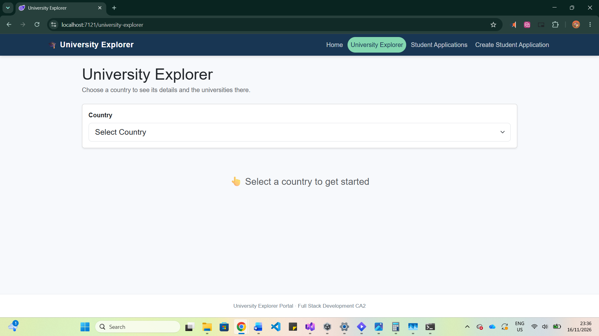
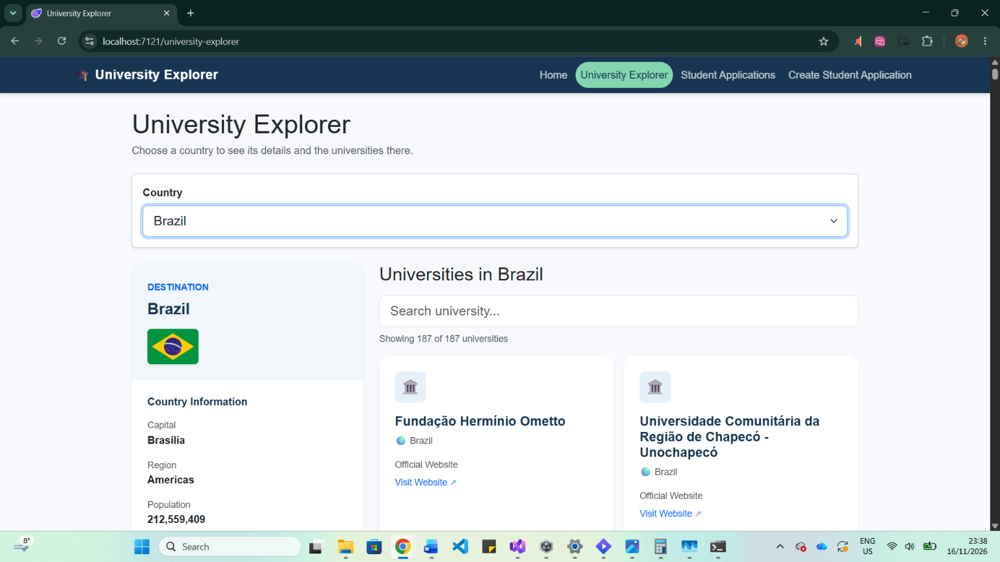
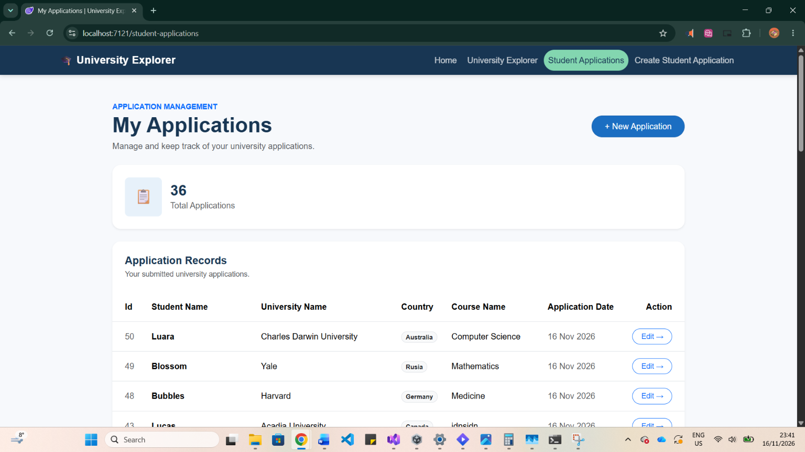
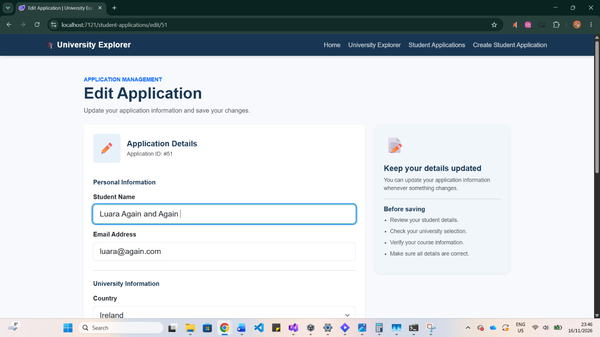
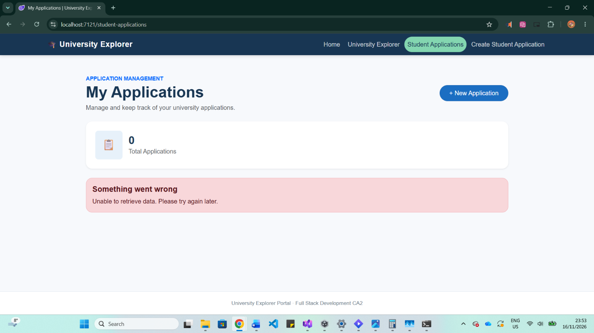

# University Explorer Portal

A Blazor Web Application that combines data from two public APIs (an **API mashup**)
to help users explore universities around the world, and lets users create and
manage university applications using the Edutots Student Application API.

**Module:** Full Stack Development | **Assessment:** CA2 (20%) | **Type:** Individual
**Author:** <<< LUARA FROES >>> | **Student ID:** <<< 78337 >>>

## Features

- **API mashup:** Countries API and Universities API combined on one page
- Country dropdown and a country details card (name, capital, region, population, flag)
- Universities list for the selected country, with live search while typing
- Full university details page (name, country, website, domains)
- "Apply to this university" button that pre-fills the application form
- View, create and edit student applications (GET, POST and PUT)
- Country and university dropdowns inside the application form
- Validation with Data Annotations, loading states and error handling
- Responsive Bootstrap design with a collapsible top navigation bar
- Reusable components using `[Parameter]` and `EventCallback`

## APIs used

| API | Purpose | Endpoint |
|---|---|---|
| Countries API | Country list and details | `https://countries.dev/countries` |
| Universities API | Universities by country | `http://universities.hipolabs.com/search?country={country}` |
| Edutots Student Application API | GET, POST and PUT applications | `https://edutots.net/api/studentapplication` |

## Technologies

- Blazor Web App (Server interactivity), .NET <<< 8 OR 10 >>>
- C#, `HttpClient`, Data Annotations
- Bootstrap
- Built with Visual Studio

## Project structure

```
UniversityExplorer
├── Models
│   ├── Country.cs
│   ├── University.cs
│   └── StudentApplication.cs
├── Services
│   ├── CountryService.cs
│   ├── UniversityService.cs
│   └── StudentApplicationService.cs
├── Components
│   ├── CountryDetails.razor
│   ├── UniversityCard.razor
│   ├── UniversityDetails.razor
│   └── StudentApplicationForm.razor
├── Components/Pages
│   ├── Home.razor                      (/)
│   ├── UniversityExplorerPage.razor    (/university-explorer)
│   ├── UniversityDetailsPage.razor     (/university-details)
│   ├── StudentApplications.razor       (/student-applications)
│   ├── CreateStudentApplication.razor  (/student-applications/create)
│   └── EditStudentApplication.razor    (/student-applications/edit/{id})
├── Screenshots
└── Program.cs
```

## How it works

- **API mashup:** when the user selects a country, the app calls the Countries API
  for its details and then the Universities API for its universities, and shows
  both on the same page.
- **Services:** each API has its own service class that uses `HttpClient`,
  registered with `AddHttpClient` in `Program.cs`.
- **Component communication:** `[Parameter]` passes data down to components, and
  `EventCallback` sends events back up (for example `UniversityCard.OnSelect`
  opens the university details page).
- **One form, two pages:** `StudentApplicationForm` is shared by the Create (POST)
  and Edit (PUT) pages.
- **Validation:** `[Required]` and `[EmailAddress]` on the `StudentApplication`
  model, displayed with `ValidationMessage`.
- **Loading and errors:** every API call is wrapped in `try/catch/finally`, with a
  spinner while loading and an alert if the request fails.

## How to run

1. Install Visual Studio with the **ASP.NET and web development** workload.
2. Clone this repository.
3. Open `UniversityExplorer.sln` in Visual Studio.
4. Press **F5** (or the green Run button). The app opens in the browser.

No API keys are needed.

## Screenshots

### 1. Home page


### 2. University Explorer page


### 3. Country selected and details displayed


### 4. Universities loaded for a selected country


### 5. University search


### 6. University details displayed


### 7. Student Applications page (GET)


### 8. Create Student Application page (POST)


### 9. Edit Student Application page (PUT)


### 10. Loading state


### 11. Error handling state


## Notes and limitations

- The Edutots API is public and shared between students, so only test data was used.
- Some country names differ between the Countries and Universities APIs, so a few
  countries may return no universities. The app shows a "No universities found"
  message and lets the user type the university name in the form.
- Course names are free text, because none of the APIs provides a course list.
