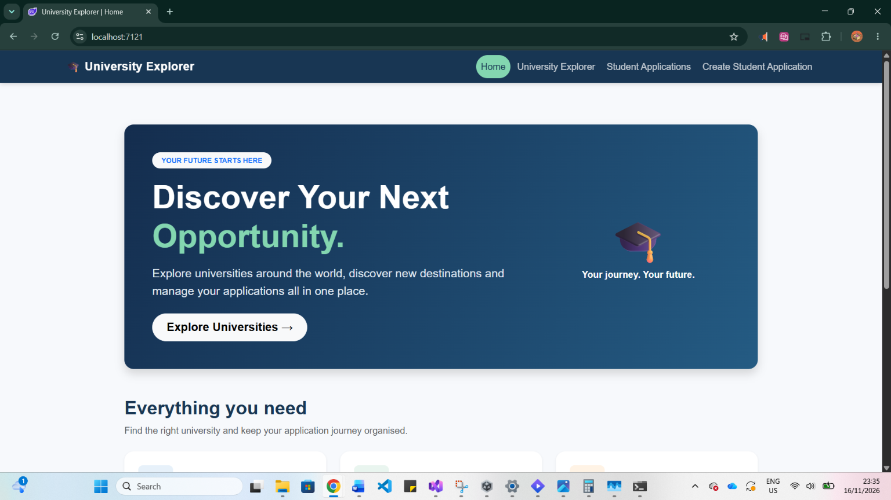
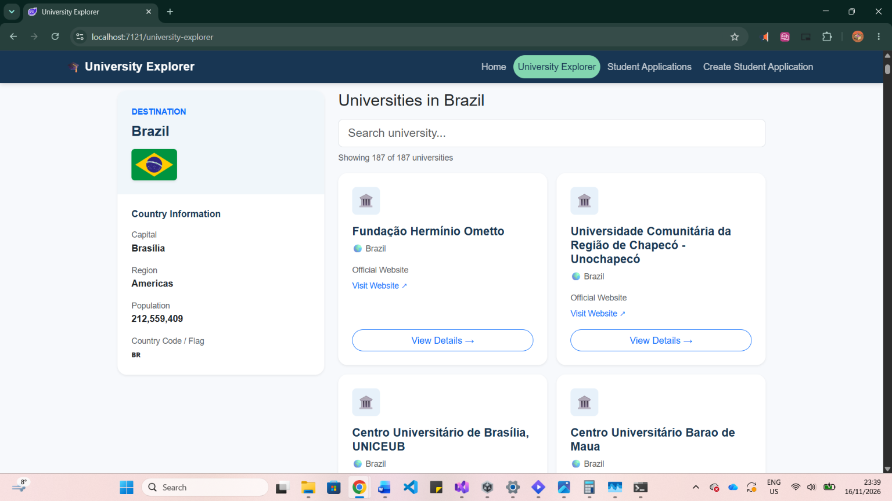
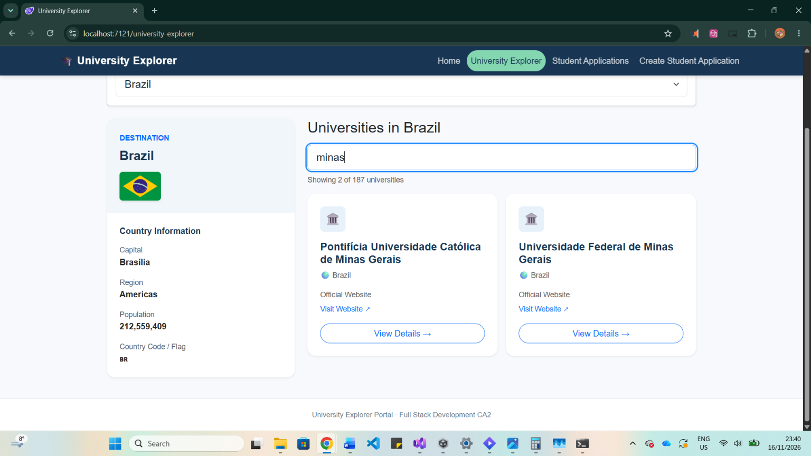
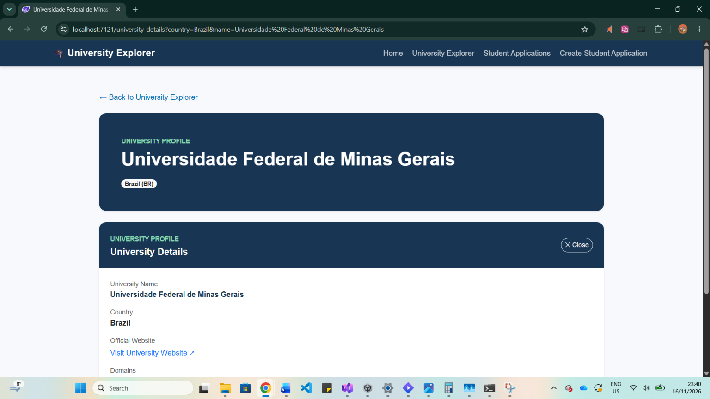
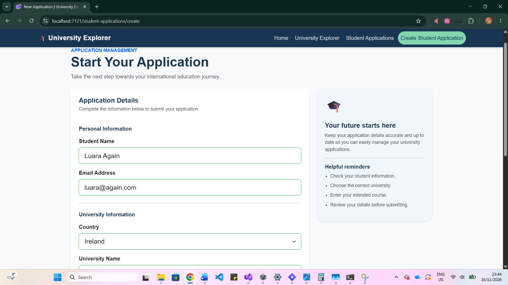
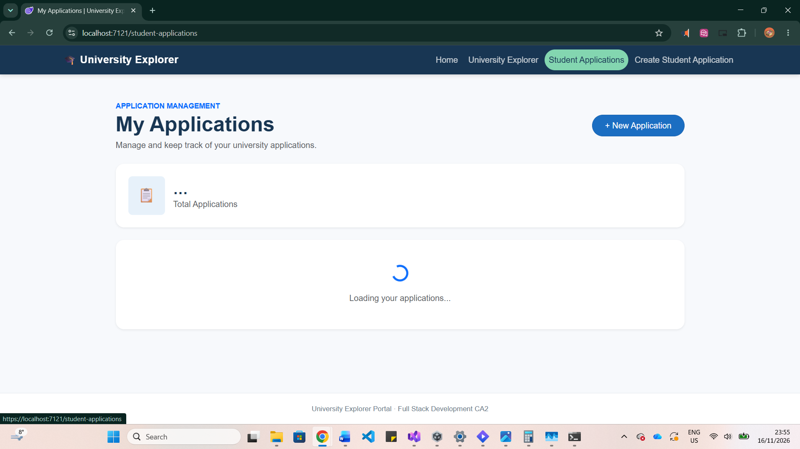

# University Explorer Portal

A Blazor Web Application that combines data from two public APIs (an **API mashup**) to help users explore universities around the world. It also allows users to create and manage university applications using the Edutots Student Application API.

**Module:** Full Stack Development | **Assessment:** CA2 (20%) | **Type:** Individual  
**Author:** LUARA FROES | **Student ID:** 78337

## Features

- **API mashup:** Combines the Countries API and Universities API on the same page.
- Country dropdown and a details card showing the country's name, capital, region, population and flag.
- List of universities for the selected country, with a search feature that updates while typing.
- Full university details page showing the name, country, website and domains.
- "Apply to this university" button that automatically fills in the university details in the application form.
- View, create and edit student applications using GET, POST and PUT requests.
- Country and university dropdowns in the application form.
- Form validation using Data Annotations, loading indicators and error handling.
- Responsive Bootstrap design with a collapsible navigation bar.
- Reusable components using `[Parameter]` and `EventCallback`.

## APIs Used

| API | Purpose | Endpoint |
|---|---|---|
| Countries API | Retrieve the list of countries and their details | `https://countries.dev/countries` |
| Universities API | Retrieve universities by country | `http://universities.hipolabs.com/search?country={country}` |
| Edutots Student Application API | View, create and update applications | `https://edutots.net/api/studentapplication` |

## Technologies

- Blazor Web App (Server interactivity), .NET 10
- C#, `HttpClient` and Data Annotations
- Bootstrap
- Visual Studio

## Project Structure

```text
UniversityExplorer
├── Models
│   ├── Country.cs
│   ├── University.cs
│   └── StudentApplication.cs
├── Services
│   ├── CountryService.cs
│   ├── UniversityService.cs
│   └── StudentApplicationService.cs
├── Components
│   ├── CountryDetails.razor
│   ├── UniversityCard.razor
│   ├── UniversityDetails.razor
│   └── StudentApplicationForm.razor
├── Components/Pages
│   ├── Home.razor                      (/)
│   ├── UniversityExplorerPage.razor    (/university-explorer)
│   ├── UniversityDetailsPage.razor     (/university-details)
│   ├── StudentApplications.razor       (/student-applications)
│   ├── CreateStudentApplication.razor  (/student-applications/create)
│   └── EditStudentApplication.razor    (/student-applications/edit/{id})
├── Screenshots
└── Program.cs
```

## How It Works

- **API mashup:** When the user selects a country, the application first gets its details from the Countries API and then retrieves its universities from the Universities API. Both results are displayed on the same page.
- **Services:** Each API has its own service class, which uses `HttpClient` to make requests. The services are registered using `AddHttpClient` in `Program.cs`.
- **Component communication:** `[Parameter]` is used to pass data to child components, while `EventCallback` allows child components to send events back to their parent. For example, `UniversityCard.OnSelect` is used to open the university details page.
- **Shared form:** The `StudentApplicationForm` component is reused on both the Create (POST) and Edit (PUT) pages, avoiding the need to create two separate forms.
- **Validation:** The `StudentApplication` model uses `[Required]` and `[EmailAddress]` to validate the form. Validation messages are displayed using `ValidationMessage`.
- **Loading and error handling:** API requests are handled using `try/catch/finally`. A loading spinner is displayed while a request is running, and an alert is shown if something goes wrong.

## How to Run

1. Install Visual Studio with the **ASP.NET and web development** workload.
2. Clone this repository.
3. Open `UniversityExplorer.sln` in Visual Studio.
4. Press **F5** or click the green Run button to start the application. It will open in your browser.

No API keys are required.

## Screenshots

### 1. Home Page


### 2. University Explorer Page


### 3. Country Selected and Details Displayed


### 4. Universities Loaded for a Selected Country


### 5. University Search


### 6. University Details Displayed


### 7. Student Applications Page (GET)


### 8. Create Student Application Page (POST)


### 9. Edit Student Application Page (PUT)


### 10. Loading State


### 11. Error Handling State


## Notes and Limitations

- The Edutots API is public and shared between students, so only test data was used.
- Some country names are different between the Countries API and Universities API. Because of this, some countries may not return any universities. In these cases, the application displays a "No universities found" message and allows the user to type the university name manually in the form.
- Course names are entered as free text because none of the APIs provides a list of available courses.

## Distinction Features

- **Pagination:** The universities list displays 12 universities per page and works together with the search feature.
- **Dark mode:** A toggle in the navigation bar allows users to switch between light and dark mode. The selected theme is saved in the browser's Local Storage.
- **Local Storage persistence:** The application remembers the selected theme when the user visits again.
- **Responsive Bootstrap design:** Includes a collapsible navigation bar, responsive grid layout and cards to make the application easier to use on different screen sizes.
